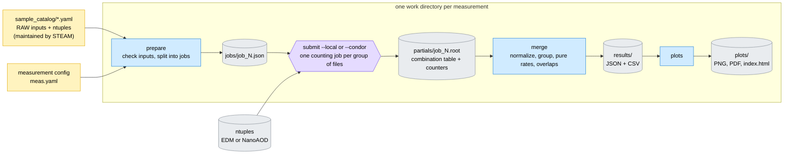
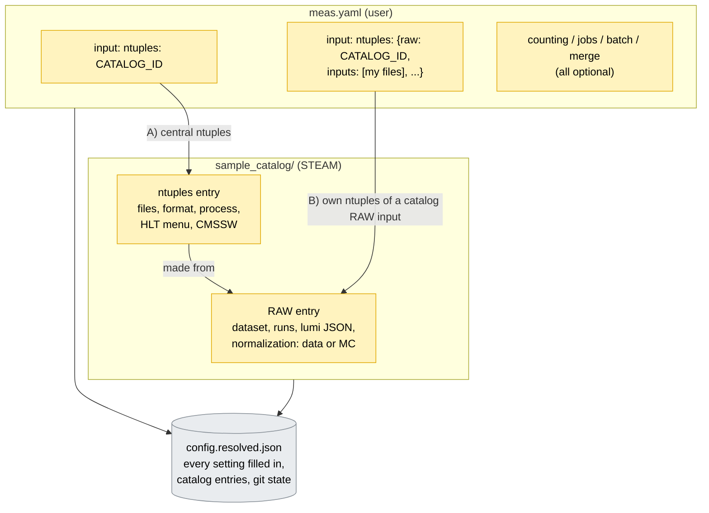
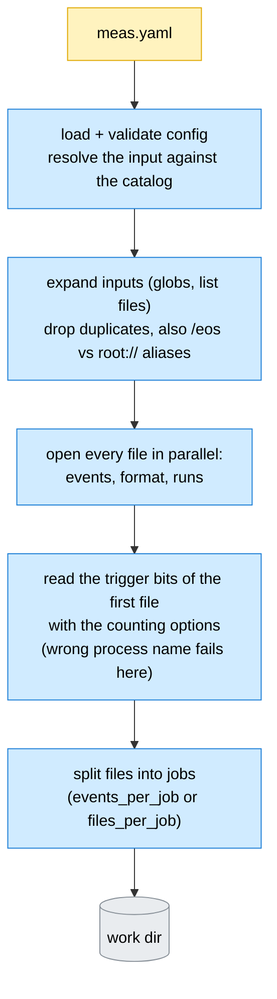
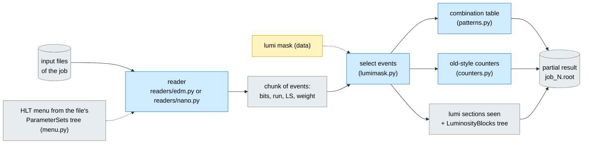
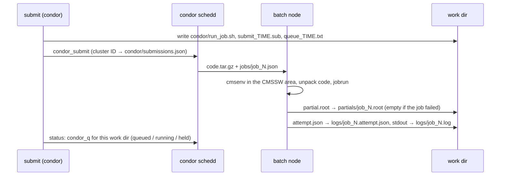
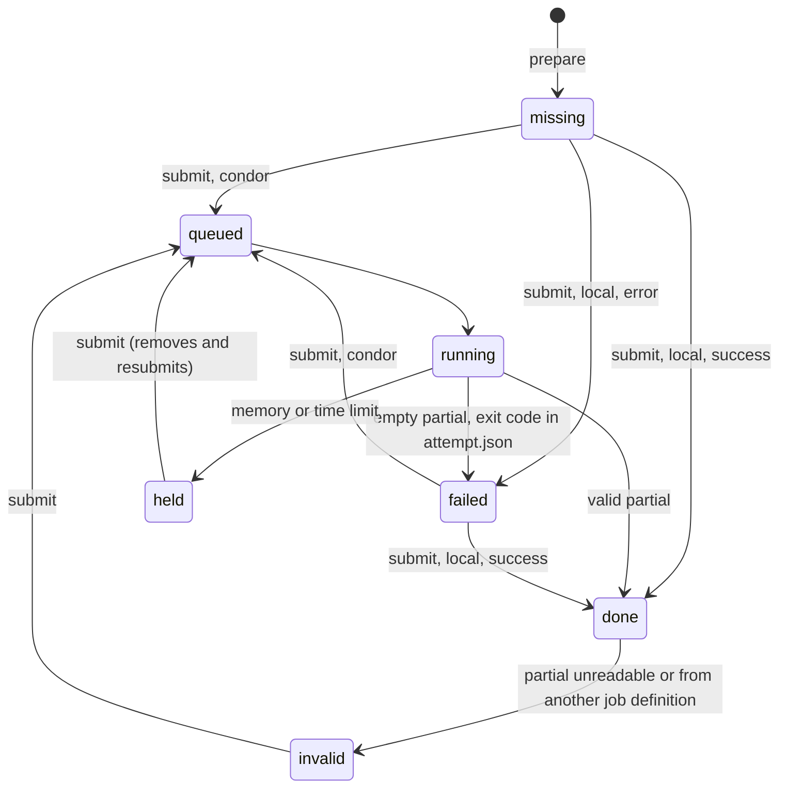
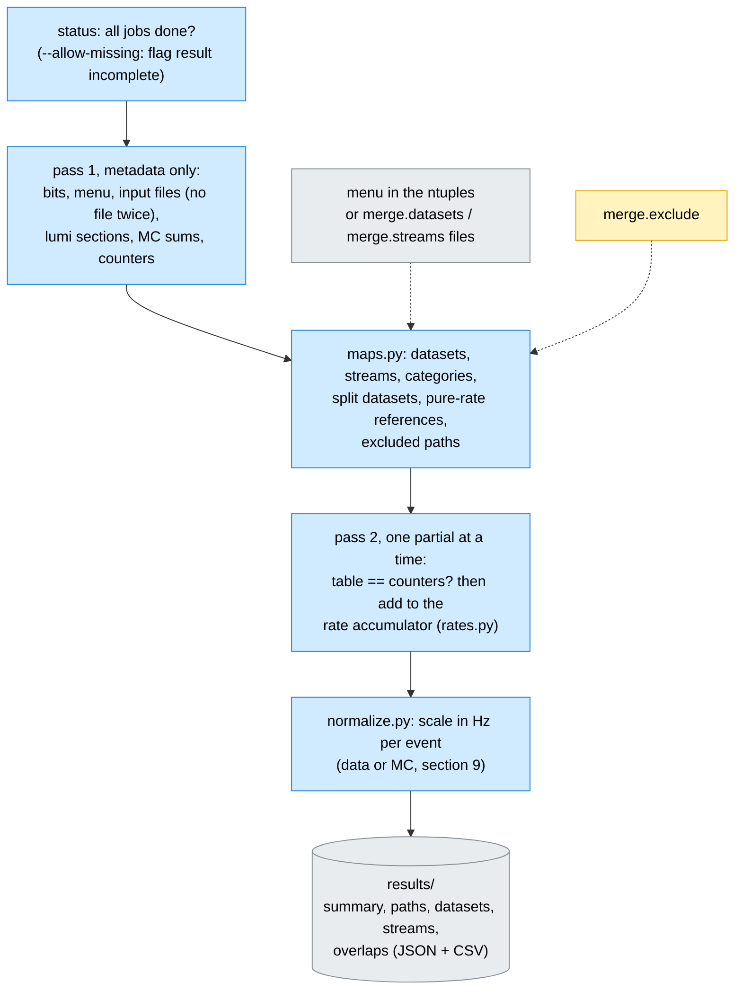
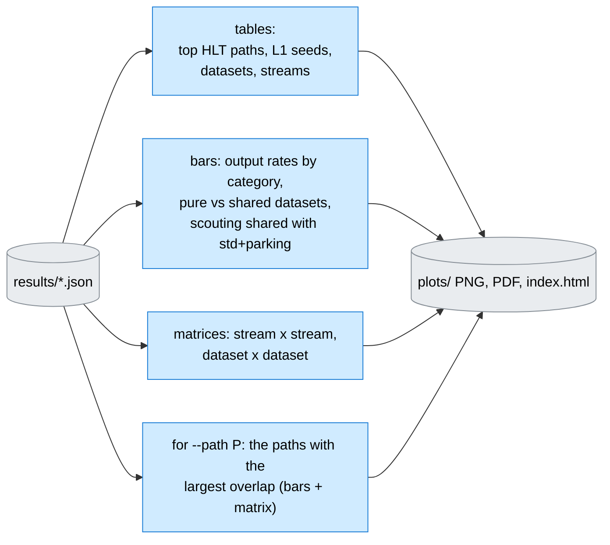

# SteamRatesEdmWorkflow – how the steamrates workflow fits together

This page describes the **new** rate workflow, the `steamrates` package (state of November 2026).
It is a map for people who run measurements, debug them, or change the code. The workflow before
the rewrite is described in [WORKFLOW_original.md](WORKFLOW_original.md); section 10 lists what
replaced what.

Command details, options and file formats are in [`steamrates/README.md`](../steamrates/README.md)
and in the docstrings of the modules named below.

The diagrams are written in [Mermaid](https://mermaid.js.org/). They render directly on GitHub.
In VS Code you need a Mermaid-capable Markdown preview, for example the
"Markdown Preview Mermaid Support" extension.

**Colour key, the same in all diagrams** (as in the original page):

| Colour | Meaning |
|---|---|
| 🟨 yellow | file or values **you edit by hand** |
| 🟦 blue | command or module that runs |
| ⬜ grey | generated file or directory |
| 🟪 purple | HTCondor batch step |
| 🟧 orange | works, but has a known limitation (see [Limitations](#11-limitations-and-open-items)) |

Contents:
1. [Big picture](#1-big-picture)
2. [Commands](#2-commands)
3. [Inputs: sample catalog and measurement config](#3-inputs-sample-catalog-and-measurement-config)
4. [prepare and the work directory](#4-prepare-and-the-work-directory)
5. [A counting job](#5-a-counting-job)
6. [Running the jobs: local and HTCondor](#6-running-the-jobs-local-and-htcondor)
7. [merge: from partial results to rates](#7-merge-from-partial-results-to-rates)
8. [Outputs and plots](#8-outputs-and-plots)
9. [Data vs. MC](#9-data-vs-mc)
10. [What replaced what](#10-what-replaced-what)
11. [Limitations and open items](#11-limitations-and-open-items)

---

## 1. Big picture

A measurement counts how often each trigger path (HLT paths and, if the ntuples have them, L1
seeds) fires in a sample of ntuples, and converts the counts into rates. The ntuples are either
the STEAM EDM ntuples of step 1 (`Prod/`, unchanged so far) or NanoAOD-style ntuples with trigger
bits (central PromptReco NanoAOD, or the common L1+HLT ntuple format).



The key idea: **a counting job does not compute rates.** It stores every distinct combination of
fired bits once, with the number of events (MC: the sum of weights and of squared weights). Path,
dataset and stream rates, pure rates, totals and overlaps are all sums over these rows, computed
at merge time. Changing a dataset definition, an exclusion or the normalization therefore never
requires reading the ntuples again (section 5).

---

## 2. Commands

All commands run from the repository root inside a CMSSW environment (`cmsenv`):
`python3 -m steamrates <command> ...`. Only uproot, awkward, numpy, scipy and matplotlib are used;
no PyROOT or FWLite.

| Command | What it does | Module |
|---|---|---|
| `catalog list` / `catalog show ID` | browse the sample catalog | `catalog.py` |
| `prepare meas.yaml -w WD` | config → work dir with one job file per counting job | `prepare.py` |
| `submit WD --local -j 8` | run the jobs that are not done, on this machine | `batch.py` |
| `submit WD --condor` | the same on HTCondor (lxplus) | `batch.py`, `condor.py` |
| `status WD` | done / running / queued / held / failed / invalid / missing | `jobstatus.py` |
| `merge WD` | partial results → normalized rates in `WD/results/` | `merge.py` |
| `plots WD` | tables and figures in `WD/plots/` | `plots.py` |
| `run meas.yaml -w WD [--condor]` | prepare + submit + merge in one go | `run.py` |
| `count ...` | count files into one partial result (what a job runs) | `count.py` |
| `summary partial*.root` | look at / add up partial results (raw counts) | `summary.py` |

Every command can be repeated safely: `prepare` does nothing if nothing changed, `submit` only runs
jobs without a valid result, and `merge` and `plots` overwrite their outputs.

---

## 3. Inputs: sample catalog and measurement config

The input of a measurement comes in two parts with different owners:

- the **sample catalog** (`sample_catalog/*.yaml`, maintained by STEAM): the central RAW inputs
  with everything the normalization needs (data: sample prescale, average luminosity, lumi JSON;
  MC: cross section or number of colliding bunches), and the ntuple sets made from them (path or
  glob, format, CMSSW, HLT menu, process). The schema is documented in `catalog.py`.
- the **measurement config** (one YAML file, written by the user): which input to use, plus
  optional settings for counting, jobs, batch and merge. Every key is checked; an unknown key is an
  error. `steamrates/examples/reference.yaml` lists every key with its default.



A minimal config:

```yaml
name: rates_403663_PromptNano
input:
  ntuples: Run2026D_403663_HLTPhysics_PromptNano
jobs: {events_per_job: 500000}
```

---

## 4. prepare and the work directory

`prepare` turns the config into a work directory. Everything of a measurement lives below it, so
several measurements can run at the same time from one checkout, and nothing is written into the
code checkout.



Work-directory layout (`workdir.py`):

```text
WORKDIR/
  config.yaml               verbatim copy of the measurement config
  config.resolved.json      every setting filled in, resolved catalog entries, git state, sha1s
  code/steamrates/          snapshot of the package used by the jobs: editing the checkout
  code.tar.gz               while jobs run does not affect them; batch jobs unpack the tarball
  inputs/files.json         input files after expansion and duplicate removal (+ per-file checks)
  jobs/jobs.json            job table: id, files, number of events, output, key
  jobs/job_<id>.json        everything one counting job needs
  partials/job_<id>.root    one partial result per job
  logs/                     job_<id>.log, job_<id>.attempt.json; logs/condor/ for HTCondor
  condor/                   job wrapper, submit files, submissions.json
  results/                  normalized rates (merge)
  plots/                    tables and figures (plots)
```

Each job has a **key**, the sha1 of what it counts (files, counting options, lumi mask). After a
change of the config, `prepare --force` keeps the partial results of jobs whose key did not change;
merge settings never change a key, so re-merging with other settings costs no counting.

---

## 5. A counting job

A job reads its files in chunks of events (default 50 000, which bounds the memory) and fills two
things at once.



- **Readers.** EDM ntuples: `edm::TriggerResults` and the event IDs are decoded from raw bytes with
  uproot (the byte layouts are documented in `readers/edm.py`); the path names come from the menu
  stored in the file. NanoAOD: the flat `HLT_*`, `DST_*`, `L1_*`, ... branches; the process of the
  bits is taken from the branch title, because re-HLT NanoAOD contains the bits of several processes.
- **Combination table.** One row per distinct set of fired bits, with `count`, `sumw`, `sumw2`. In
  data, events share few combinations (a few % of the events), so the table is small. In MC almost
  every event is its own row; the table is then a compact per-event bit list.
  Illustration (made-up numbers):

  | row | fired bits | count |
  |---|---|---|
  | 0 | HLT_IsoMu24, HLT_IsoMu27, L1_SingleMu22 | 812 |
  | 1 | HLT_IsoMu24, L1_SingleMu22 | 140 |
  | 2 | DST_PFScouting_JetHT, L1_HTT280er | 3561 |

  The rate of HLT_IsoMu24 is the sum over rows 0 and 1; its pure rate is the sum over rows where it
  is the only path of its reference group; the IsoMu24 × IsoMu27 overlap is row 0.
- **Counters.** Per-bit count, pure count and totals, filled directly in the event loop like the
  legacy script. The merge checks that the table reproduces them. With `counting: {table: false}`
  they replace the table for very large samples (then no datasets, streams or overlaps).
- **Safety.** A file counted twice and repeated (run, LS, event) are errors; the output is written
  atomically (temporary file + rename).

---

## 6. Running the jobs: local and HTCondor

Both executors run the same thing per job: `python3 -m steamrates.jobrun jobs/job_N.json` with the
code snapshot of the work dir. Only jobs without a valid partial result run, so after a failure you
fix the cause and repeat the command.

- **Local** (`submit --local -j N`): N jobs at a time as separate processes; log and attempt record
  (exit code, CPU, memory) per job in `logs/`.
- **HTCondor** (`submit --condor`, `condor.py`): one cluster per submission, with the `batch`
  settings of the config (job flavour, memory, grid proxy, CMSSW area). Work dirs on EOS go through
  the eossubmit schedds automatically (`module load lxbatch/eossubmit` is applied for you).



Job states, as shown by `status` (`jobstatus.py`):



A failed condor job does not go on hold: the wrapper always returns an (empty) partial and the
attempt record, so `status` shows the exit code and the end of the log. `submit` never resubmits
jobs that are still queued or running. `run --condor` and `submit --condor --wait` wait until no
job is queued or running.

---

## 7. merge: from partial results to rates

The merge streams over the partial results, so its memory is that of one partial's table plus the
accumulators, independent of the number of jobs (important for a future web server with little
memory).



**Categories** come from the stream names of the menu: `Physics*` streams are *standard*,
`Parking*` *parking*, `Scouting*` *scouting*, all other streams *other* (calibration,
monitoring, express, ...). A path takes the categories of the streams its datasets go to; paths in
no dataset have category *none*. Menus without streams (Phase-2 so far): `^DST_.*Scouting` paths
are scouting, `^HLT_` paths standard.

**Pure rate** (events in which the path, dataset or stream is the only one of its reference group):

| Item | Reference group |
|---|---|
| standard and parking paths, datasets, streams | all standard + parking ones |
| scouting paths, datasets, streams | all scouting ones |
| other / none | none: pure rate 0 (kept as 0 for spreadsheets) |
| L1 seeds | all other L1 seeds |

Scouting overlaps with standard and parking by design, so instead of a pure rate the merge gives
the **shared rate and fraction with standard + parking** for scouting paths, datasets and streams.

**Split datasets and streams** (e.g. EGamma0–5, filled round robin through `Dataset_` path
prescales) appear in two variants: `datasets_split` / `streams_split` give what each one writes
(from its `Dataset_` bit, or estimated from the menu's dataset prescale if the ntuples do not have
that bit), and `datasets` / `streams` combine them (EGamma = EGamma0 + ... + EGamma5) with pure
rates and overlaps.

**Excluded paths** (`merge.exclude`, plus `HLT_Physics` and `HLT_EphemeralPhysics` by default,
because they select the HLTPhysics samples) keep their own rate and stay in the dataset and stream
rates and overlaps, but are left out of the totals and of the pure-rate references. Every excluded
bit is listed in `excluded_paths.json`.

**Checks** in `summary.json`: counters vs table, split datasets add up to the combined one, bits
that fired but are not in the menu (an error), `Status_OnCPU/OnGPU` equal to the input rate,
warnings for paths that fire in almost every event.

---

## 8. Outputs and plots

`WD/results/` (formats documented in `results.py`):

| File | Content |
|---|---|
| `summary.json` | input, normalization, totals (input, standard, parking, scouting, ...), checks, warnings |
| `paths_hlt.json/.csv` | per HLT path: rate, pure rate, shared with standard+parking, category, datasets, prescale |
| `paths_l1.json/.csv` | per L1 seed: rate, pure rate |
| `datasets[_split].json/.csv`, `streams[_split].json/.csv` | combined and split datasets/streams |
| `overlaps_*.json` | sparse overlap matrices: datasets, streams, paths, paths × datasets, L1 × datasets, L1 × streams, L1 × L1, paths × L1 (L1 × L1 and paths × L1: one L1 flavour, `_final` for Phase-2) |
| `paths_without_dataset.json`, `excluded_paths.json` | lists to review |

Rates have statistical errors (from Σw²). JSON is meant for a future comparison website, CSV for
spreadsheets.

`python3 -m steamrates plots WD` (`plots.py`) reads only `results/` and writes PNG + PDF figures and
an `index.html` gallery to `WD/plots/`:



Overlap matrices show, in cell (row, column), the fraction of the row's events in which the column
also fired. Items that fire in nearly every event of the sample (in HLTPhysics data, HLT_Physics and
the datasets that contain it) are left out and named in a footnote. The figure functions can be
reused in notebooks (`Results`, `Overlap`, `fig_*`).

---

## 9. Data vs. MC

There is one pipeline. A sample's kind only changes the event selection and the normalization
(`normalize.py`); the scale is in Hz per event (per unit weight for MC).

| Mode (catalog RAW entry) | Event selection | Scale |
|---|---|---|
| `data` | lumi JSON | prescale × (target lumi / lumi) / (N_LS × 23.311 s) |
| MC `cross_section` | none | σ × filter efficiency × target lumi / Σw (generated) |
| MC `bunch_crossing` (e.g. NuGun) | none | n_bunches × 11245.5 Hz / Σw |

- **N_LS** is the number of distinct (run, LS) pairs listed in the input files' LuminosityBlocks
  trees (after the lumi JSON), counted once however many jobs and files an LS is spread over. The
  legacy sum of per-job LS counts needed the number of parallel datasets folded into the prescale.
- **prescale** is the sample prescale of all its datasets together (e.g. 220 for
  EphemeralHLTPhysics 0–7 with a 220 path prescale; 5350 for HLTPhysics = 50 × the hidden 107 of
  the `HLTL1NumberFilter`).
- **LS length** = 2^18 orbits / 11245.5 Hz = 23.3110 s (legacy: 23.31).
- **MC Σw**: `genEventSumw` (or `genEventCount`) of the Runs trees if every file has it, so ntuples
  that keep only triggered events are normalized to the generated events; otherwise the counted
  events, with a warning.

---

## 10. What replaced what

| Legacy (see WORKFLOW_original.md) | steamrates |
|---|---|
| ~10 files with settings (`config_makeCondorJobsData.py`, `config_mergeOutputsData.py`, `triggerstoexclude.py`, ...) | one measurement config + the sample catalog |
| `Jobs/`, `Results/`, `filesInputData.py` inside the checkout (one measurement at a time) | one work dir per measurement, code snapshot per work dir |
| `triggerCountsFromTriggerResults.py` (FWLite, ~1k events/s; per-event JSON parsing, map scans) | `count.py` with uproot readers (~16k events/s for EDM); counting ~75× faster in wall time |
| counts per job in CSV, fixed observables | combination table + counters in a ROOT partial; any grouping at merge time |
| `condorScriptForRatesData.py`, `handleFileTransfer.py` (outputs could get lost silently) | `submit --local / --condor`, `status`; outputs via condor file transfer, failures visible |
| `mergeOutputs.py` (N_LS summed per job, LS length 23.31) | `merge.py` (distinct LS, explicit normalization, checks) |
| `STEAM_maps/` + `Menu_HLT.py` (ConfDB, copied by hand) | datasets/streams from the menu stored in the ntuples |
| maps modes `nomaps` / `somemaps` / `allmaps` | always all groupings; categories from stream names |
| pure rate against "fired `HLT_` paths" + `triggerstoexclude.py` | pure rate per reference group (section 7) |
| `Draw.py` | `plots.py` |
| separate MC scripts | one pipeline, MC normalization modes |
| no L1 rates | L1 seeds from NanoAOD, with pure rates and overlaps with datasets/streams |

Validated against the legacy workflow: identical total and pure counts for all paths of run 402360
(1136 files) and, for the datasets and streams whose definitions agree, identical counts for run
403663. Compared with the online rates of run 403663, most HLT paths and L1 seeds agree within
the statistical errors; the outliers are understood (e.g. paths seeded by random or calibration
triggers, which have no events in HLTPhysics samples).

---

## 11. Limitations and open items

- Step 1 (`Prod/`, producing the EDM ntuples) is unchanged; a `produce` mode is planned, and the
  common L1+HLT ntuple format may replace it.
- Per-filter rates need the last-module index per path, which NanoAOD does not store (the EDM
  ntuples do; not used yet).
- L1 rates in central NanoAOD are after L1 prescales and masks; unprescaled L1 bits are needed to
  apply other L1 columns. MC menus have no prescales: prescale application at merge time is planned.
- Planned: pure rates of paths within their stream, PAG/POG
  groups, per-LS luminosity/prescale weights, event sizes for bandwidths, the merge as a batch job
  (for a web server), combining several work dirs (e.g. pT-binned MC).
- HTCondor submission has been tested from EOS work dirs (eossubmit); AFS work dirs are expected to
  work the same way but have not been tested yet.
