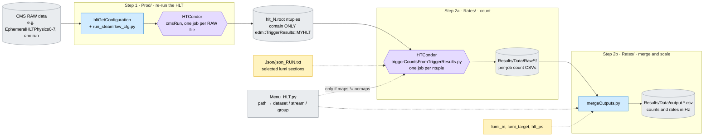
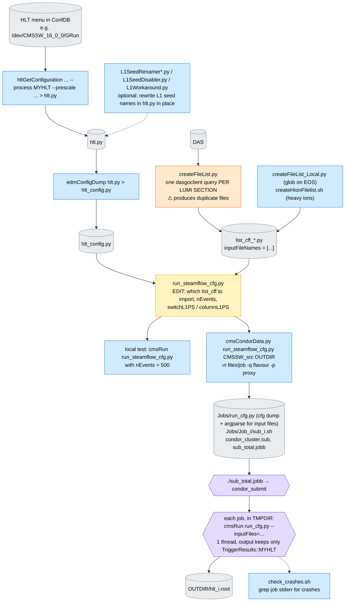
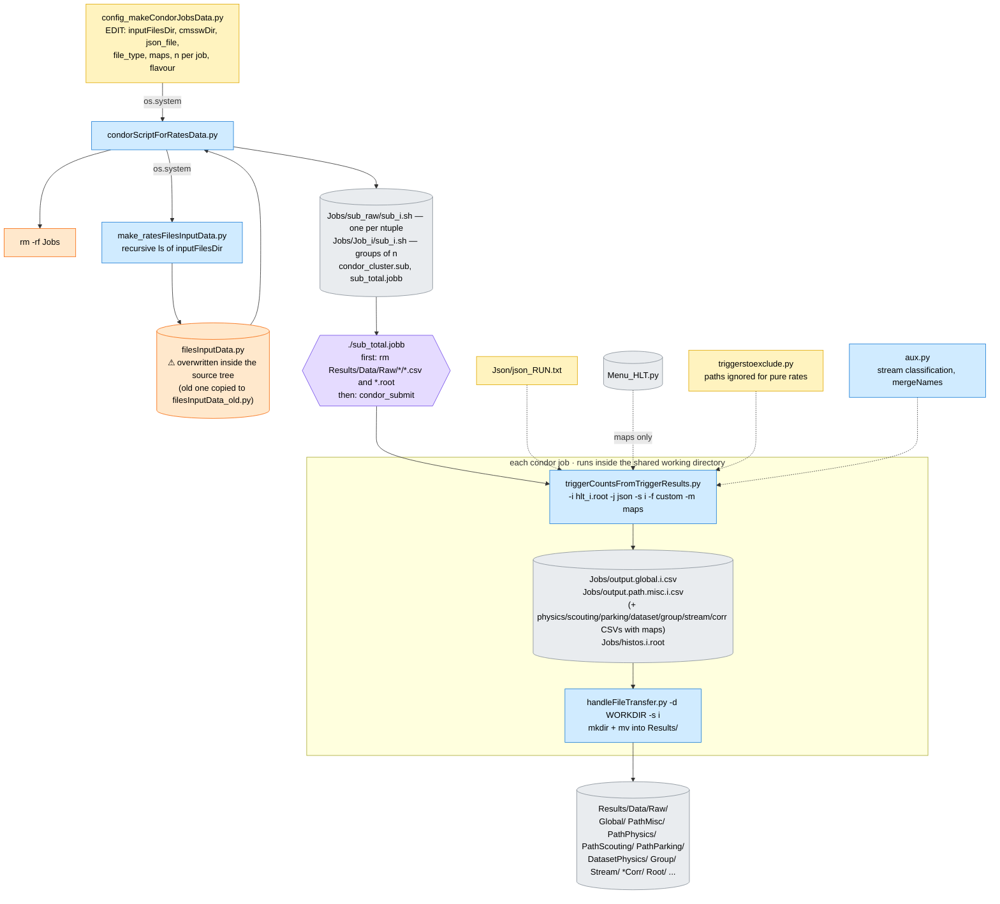
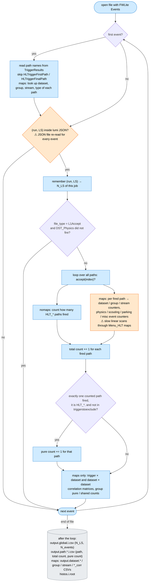
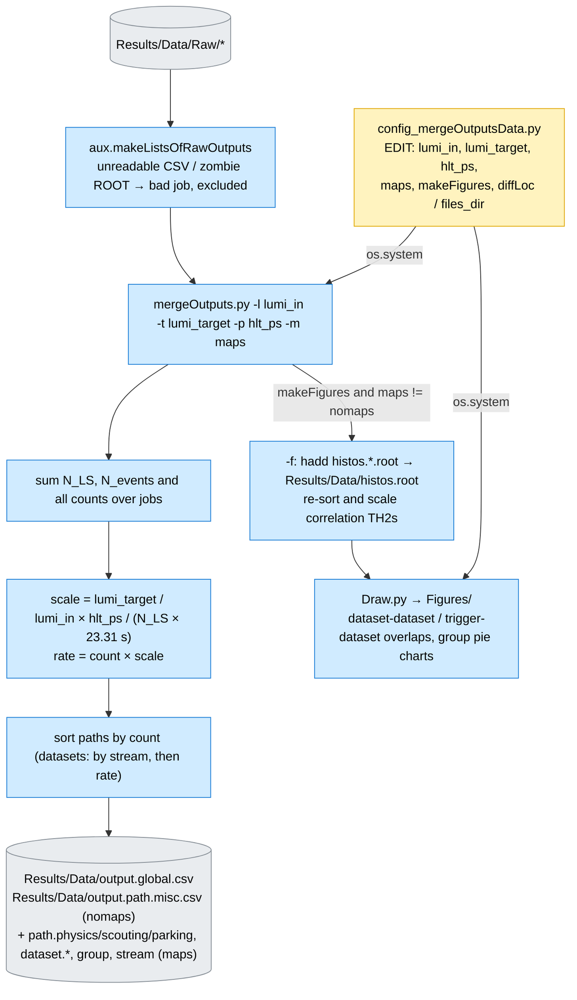
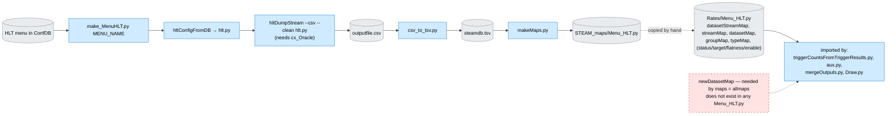
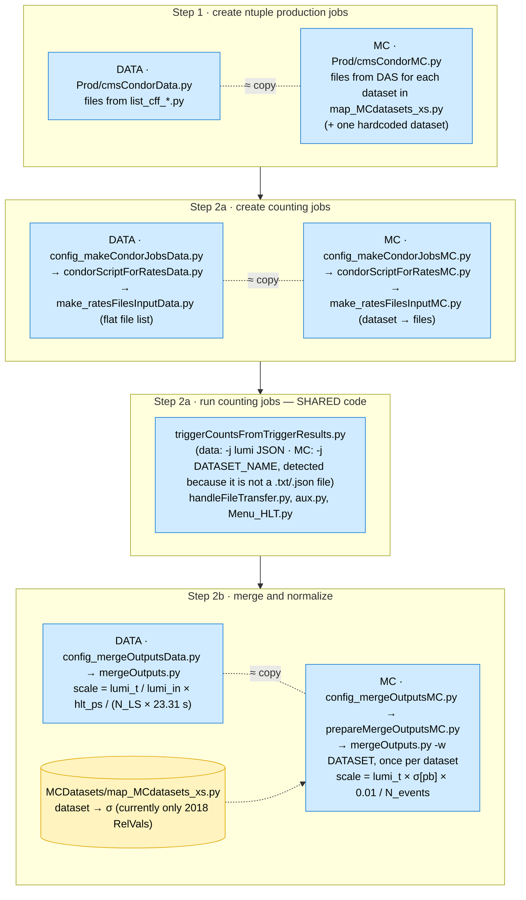
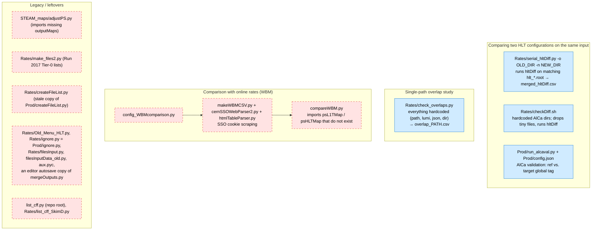

# SteamRatesEdmWorkflow – how the current workflow fits together

This page describes the workflow **as it is today** (the state before the planned refactor).
It is meant as a map for people who need to run the workflow, debug it, or change it.

The diagrams are written in [Mermaid](https://mermaid.js.org/). They render directly on GitHub.
In VS Code you need a Mermaid-capable Markdown preview, for example the
"Markdown Preview Mermaid Support" extension.

**Colour key, the same in all diagrams:**

| Colour | Meaning |
|---|---|
| 🟨 yellow | file or values **you edit by hand** before a run |
| 🟦 blue | script that is run (by you or by another script) |
| ⬜ grey | generated file or directory |
| 🟪 purple | HTCondor batch step |
| 🟧 orange | works, but has a known problem (see [Known issues](#known-issues)) |
| 🟥 red, dashed | broken or legacy |

Contents:
1. [Big picture](#1-big-picture)
2. [Step 1 – producing the HLT ntuples (`Prod/`)](#2-step-1--producing-the-hlt-ntuples-prod)
3. [Step 2a – counting jobs (`Rates/`)](#3-step-2a--counting-jobs-rates)
4. [What the counting script does per event](#4-what-the-counting-script-does-per-event)
5. [Step 2b – merging and computing rates](#5-step-2b--merging-and-computing-rates)
6. [The trigger maps (`STEAM_maps/` → `Menu_HLT.py`)](#6-the-trigger-maps-steam_maps--menu_hltpy)
7. [Data vs. MC](#7-data-vs-mc)
8. [Other tools in the repo](#8-other-tools-in-the-repo)
9. [Where every user setting lives](#9-where-every-user-setting-lives)
10. [Known issues](#known-issues)
11. [Design principles for the refactor](#design-principles-for-the-refactor)

---

## 1. Big picture

The workflow re-runs a new HLT menu on recorded RAW data. It then counts how often each trigger path fires and converts the counts into rates at a chosen target luminosity.

Step 1 is likely to be replaced by a common L1+HLT ntuple format produced in another repository. Step 2 is the focus of the modernization.

---

## 2. Step 1 – producing the HLT ntuples (`Prod/`)

- `run_steamflow_cfg.py` does `from hlt_config import *`, then replaces the source, adds an output module that keeps only `edmTriggerResults_*_*_MYHLT`, and forces 1 thread.
- Optionally it inserts an `L1TGlobalPrescaler` to emulate a tighter L1 prescale column.
- The ntuples therefore contain **only HLT path decisions**. There is no L1 information, no event content, and no per-module information beyond what `TriggerResults` stores.
- `Prod/run_alcaval.py` + `Prod/config.json` is a separate AlCa validation flow (reference vs. target global tag). It is not part of the rate workflow.

---

## 3. Step 2a – counting jobs (`Rates/`)

- Everything is wired together with `os.system(...)` calls and fixed relative paths: `Jobs/`, `Results/`, `filesInputData.py`, `sub_total.jobb`, `condor_cluster.sub`.
- Starting a new measurement **deletes the previous one's job directory and raw results**. Two measurements can therefore not run from the same checkout at the same time.
- `file_type`: `custom` reads `TriggerResults::MYHLT` (STEAM ntuples). `RAW` reads `TriggerResults::HLT` (online decisions in RAW). `L1Accept` is like `RAW`, but keeps only events where `DST_Physics` fired.

---

## 4. What the counting script does per event

`Rates/triggerCountsFromTriggerResults.py` processes **one ntuple file**:

Definitions used by the current code:
- **Total count of a path**: the number of selected events in which the path fired.
- **Pure count of a path**: the number of events in which this path was the *only* "counted" path that fired.
  - With `nomaps`, "counted" means any `HLT_*` path.
  - With maps, it means any path in a physics stream (excluding HLTPhysics, ZeroBias, parking and the scouting monitors).
  - Paths in `triggerstoexclude.py` never get a pure count.
- The CSV columns are named "Rate (Hz)", but at this stage they hold **raw counts**. They are converted to rates in the merge step.

---

## 5. Step 2b – merging and computing rates

**Scale factor, worked example** (run 402360, 8 EphemeralHLTPhysics datasets, LS 193–334):

| quantity | value |
|---|---|
| N_LS (summed over jobs) | 1136 = 8 datasets × 142 LS |
| N_events | 5,721,135 |
| hlt_ps | 480 = 60 (HLTPhysics prescale) × 8 (number of Ephemeral datasets) |
| lumi_in = lumi_target | 2.2e34 |
| scale | 1 × 480 / (1136 × 23.31 s) = 0.01813 Hz per count |

Note that the factor 8 appears in **both** N_LS and hlt_ps and cancels. This is only correct as long as every (dataset, LS) pair ends up in exactly one ntuple file (see [Known issues](#known-issues)).

---

## 6. The trigger maps (`STEAM_maps/` → `Menu_HLT.py`)

The maps assign each path to its stream, primary dataset, physics group(s) and type. They are only needed with `maps = somemaps / allmaps`, and for the figures.

Map keys are path names with the version number stripped (`HLT_IsoMu24_v`). The stripping is done with `rstrip("0123456789")`, which also strips digits that are part of the name (`Dataset_AlCaP0` → `Dataset_AlCaP`).

---

## 7. Data vs. MC

The MC chain is a near-copy of the data chain. The real differences are only (1) how the input files are listed and selected, and (2) the normalization.

Each row below is one stage. The left box is the Data script and the right box its MC twin (dotted line = near-copy).

MC will become the main use case (HL-LHC / Phase-2 menu preparation), so the refactored code should treat data and MC as two configurations of **one** pipeline (see [Design principles](#design-principles-for-the-refactor)).

---

## 8. Other tools in the repo

---

## 9. Where every user setting lives

Everything below is the input for the planned "single configuration file".

| Setting | Where it is set today | Notes |
|---|---|---|
| HLT menu, global tag, prescale column, process name | `hltGetConfiguration` command line (README) | process name `MYHLT` is also hardcoded in `run_steamflow_cfg.py` and the counter |
| L1 seed renames / disables | dicts inside `Prod/L1Seed*.py`, `Prod/L1Workaround.py` | edit `hlt.py` in place |
| RAW input datasets, run, LS range | `Prod/createFileList.py` (top of file) | output file name also hardcoded |
| which file list to run on | `from list_cff_... import` in `Prod/run_steamflow_cfg.py` | |
| nEvents, switchL1PS, columnL1PS, output name | `Prod/run_steamflow_cfg.py` | nEvents must be reset to -1 after the local test |
| CMSSW dir, output dir, files/job, flavour, proxy | `cmsCondorData.py` command line | |
| ntuple directory, CMSSW dir, file_type | `Rates/config_makeCondorJobsData.py` | |
| lumi JSON | `Rates/config_makeCondorJobsData.py` → `Rates/Json/*.txt` | |
| maps mode | `config_makeCondorJobsData.py` **and** `config_mergeOutputsData.py` | must be kept consistent by hand |
| files/job, flavour (counting) | `config_makeCondorJobsData.py` (`isUnusual`, `n`, `flavour`) | |
| lumi_in, lumi_target, hlt_ps | `Rates/config_mergeOutputsData.py` | history of values kept as comments |
| makeFigures, input dir for merging | `Rates/config_mergeOutputsData.py` | |
| paths excluded from pure rates | `Rates/triggerstoexclude.py` | |
| path → dataset/stream/group/type | `Rates/Menu_HLT.py` (generated in `STEAM_maps/`, copied by hand) | |
| stream classification rules (what counts as physics/scouting/parking) | string rules inside `Rates/aux.py` | |
| PAG list, datasets for correlation plots | `Rates/aux.py` (`PAGlist`, `datasets_for_corr`) | `datasets_for_corr` still uses Run-2 names |
| LS length 23.31 s | `Rates/mergeOutputs.py` | |
| MC cross sections | `MCDatasets/map_MCdatasets_xs.py` | |
| target lumi (MC) | `Rates/config_mergeOutputsMC.py` | |

---

## Known issues

Performance (mostly relevant for `maps` mode):
1. `check_json` re-opens and re-parses the lumi JSON for **every event**.
2. The list `tnames` is extended by all excluded triggers on **every event** and never reset (`triggerCountsFromTriggerResults.py:368-369`). Memory grows and the `in tnames` check gets slower with every event.
3. `physicsStreamOK` / `scoutingStreamOK` / `parkingStreamOK` / `belongsToPAG` (`aux.py`) scan all ~750 map entries (with `rstrip`) for every fired path in every event. Several `x in list(d.keys())` checks add to this. This is the main reason maps are slow.

Correctness / robustness:

4. Version stripping with `rstrip("0123456789")` also removes digits that belong to the name. `Dataset_ScoutingPF0` and `Dataset_ScoutingPF1` collide, and `EGamma0` becomes `EGamma`.
5. "Pure" is defined against different path sets in `nomaps` and maps mode (see section 4).
6. `maps = allmaps` crashes, because `newDatasetMap` exists in no `Menu_HLT.py`. `compareWBM.py` and `adjustPS.py` import maps that do not exist.
7. **Duplicate files in input lists.** `Prod/createFileList.py` queries DAS once per lumi section and appends all results without deduplication. A RAW file that contains several LS is therefore listed several times. Commit 68d5b60 removed such duplicates by hand.
8. **N_LS normalization relies on implicit assumptions.** N_LS is counted per job and summed without deduplication. This is correct only if each (dataset, LS) pair is in exactly one ntuple file, and if `hlt_ps` contains the number of parallel datasets (factor 8 above).
   - Duplicated input files double both counts and N_LS. This wastes CPU and fakes statistics.
   - An LS split across two files is counted twice, which lowers the rates.
9. Bad-job detection in `aux.makeListsOfRawOutputs` matches job numbers as substrings of file names.
10. MC is detected by checking whether the `-j` argument looks like a JSON filename (`triggerCountsFromTriggerResults.py:126`).

Workflow / structure:

11. Shared mutable state (`Jobs/`, `filesInputData.py`, `Results/`, `sub_total.jobb`, `condor_cluster.sub`): one measurement per checkout at a time, and old results get wiped.
12. Settings are spread over ~10 files (section 9). The maps mode must be set consistently in two places.
13. MC and data scripts are copy-pasted pairs (section 7).
14. Hardcoded leftovers: `metBx` / `muonBx` histograms in every job, LS length, PAG and dataset lists, process names.
15. Output is CSV with mislabelled columns. Results live in relative paths inside the code checkout.

Capabilities that are missing today:

16. **No L1 rates**: the ntuples contain no L1 information.
17. **No per-module / per-filter rates.** However, `edm::TriggerResults` already stores, for each path, the index of the last module that ran (`HLTPathStatus::index()`). Together with the module list of each path from the menu, this would give filter-level efficiencies from the existing ntuples.

---

## Design principles for the refactor

Collected from the project goals; to be refined.

- **One configuration file per measurement**, and **one working directory per measurement**. No shared state, so several measurements can run in parallel.
- **Data and MC share one pipeline.** A sample's kind only selects
  - (a) the event selection (lumi JSON or none) and
  - (b) the normalization strategy: *data*: luminosity × prescale / (N_LS × t_LS); *MC*: cross section × filter efficiency × lumi / N_events (or the sum of weights).
- **MC first-class**: MC will be the main use case for HL-LHC / Phase-2 studies. This means per-sample cross sections, combining several samples (e.g. pT-binned QCD) into one rate, and possibly event weights.
- **Input layer decoupled from counting**, so the current STEAM ntuples and the upcoming common L1+HLT ntuple format can both be read (likely with uproot/awkward, which are available in the CMSSW environment).
- **L1 and HLT rates**, plus optional per-module / per-filter rates.
- **JSON outputs** with metadata (config, menu, run, normalization inputs), ready for a future comparison website. Possibly runnable by a web service later, so no interactive or lxplus-only assumptions in the core.
- **Fast correlation / overlap studies**, with flexible, nice-looking default plots.
- Input file lists are **deduplicated and validated** before jobs are created. Normalization inputs are explicit and checked.
